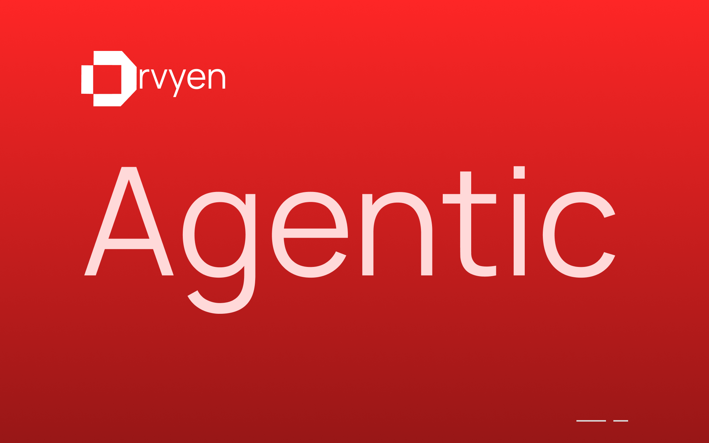

<p align="center">
  
</p>

# Orvyen Agentic

> **Static Security & Compliance Scanner for AI Agents**  
> LangChain · LangGraph · CrewAI · Model Context Protocol (MCP)

[](https://opensource.org/licenses/Apache-2.0)
[](https://pypi.org/project/orvyen-agentic/)
[](https://www.npmjs.com/package/@orvyen/agentic)
[](https://github.com/orvyen/orvyen-agentic)
[](https://www.python.org/)
[](https://owasp.org/www-project-top-10-for-large-language-model-applications/)
[](https://www.imda.gov.sg/)

Orvyen Agentic is a pre-deployment static analysis tool for AI agent codebases. It inspects Python agent graphs, prompt templates, tool privilege configurations, and MCP server manifests — surfacing security flaws and compliance gaps before code ships.

---

## Features

- **Agent-Aware AST Parsing** — Deep structural inspection of agent graphs and task orchestrations across LangChain, LangGraph, and CrewAI.
- **MCP Configuration Scanning** — Static analysis of `mcp.json` and `claude_desktop_config.json` server configs, detecting shell capabilities, plaintext credentials, and orphaned gateways.
- **Sub-100ms Execution** — Zero external runtime dependencies. All checks run via Python's standard library.
- **Agent Bill of Materials (AIBOM)** — Auditable inventory of every tool, privilege tier, model, and external data flow in the agent system.
- **Governance Scorecards**:
  - Singapore IMDA Model AI Governance Framework for Agentic AI (v1.5, May 2026 — 4 Pillars)
  - Monetary Authority of Singapore (MAS) AI Risk Management Guidelines
  - OWASP LLM Top 10 (direct vulnerability mapping)
- **CI/CD Integration** — Exit code gates on severity threshold, SARIF 2.1.0 output for GitHub Advanced Security, and machine-readable JSON.

---

## Security Rules

| Rule ID | Name | Severity | OWASP LLM Top 10 | IMDA Pillar |
| :--- | :--- | :--- | :--- | :--- |
| `OAG-001` | Tool Over-Permissioning & Dangerous Execution Scope | `CRITICAL` | LLM06: Excessive Agency | Pillar 3: Technical Controls |
| `OAG-002` | Prompt Injection Surface | `HIGH` | LLM01: Prompt Injection | Pillar 1: Assess & Bound Risk |
| `OAG-003` | Hardcoded Credentials & API Keys | `CRITICAL` | LLM02: Sensitive Information | Pillar 3: Technical Controls |
| `OAG-004` | Unfiltered PII Data Flow | `HIGH` | LLM02: Sensitive Information | Pillar 3: Technical Controls |
| `OAG-005` | Unbounded Recursion & Cycles | `HIGH` | LLM10: Unbounded Consumption | Pillar 1: Assess & Bound Risk |
| `OAG-006` | Orphaned Tools & Disconnected MCPs | `MEDIUM` | LLM06: Excessive Agency | Pillar 2: Human Accountability |
| `OAG-007` | Missing Rate Limits & Step Caps | `MEDIUM` | LLM10: Unbounded Consumption | Pillar 3: Technical Controls |
| `OAG-008` | Unaudited State-Modifying Tool Actions | `HIGH` | LLM06: Excessive Agency | Pillar 2: Human Accountability |
| `OAG-009` | Insecure MCP Transport (HTTP/SSE without TLS) | `HIGH` | LLM09: Misinformation | Pillar 3: Technical Controls |
| `OAG-010` | Missing Human-in-the-Loop for Destructive Actions | `HIGH` | LLM06: Excessive Agency | Pillar 2: Human Accountability |
| `OAG-011` | Insecure Model Configuration | `MEDIUM` | LLM09: Misinformation | Pillar 1: Assess & Bound Risk |
| `OAG-012` | Missing Output Validation & Sanitization | `MEDIUM` | LLM05: Improper Output Handling | Pillar 3: Technical Controls |

---

## Installation

**Zero-install via npx:**
```bash
npx @orvyen/agentic scan .
```

**Global npm install:**
```bash
npm install -g @orvyen/agentic
```

**Python / pip:**
```bash
pip install orvyen-agentic
```

Requires Python 3.10+. No external runtime dependencies.

---

## CLI Usage

### Scanning

```bash
# Scan current directory
orvyen-agentic scan .

# Scan a specific path
orvyen-agentic scan ./my-agent-repo

# Run via Python module
python -m orvyen.cli scan ./my-agent-repo
```

### Output Formats

| Format | Flag | Description |
| :--- | :--- | :--- |
| Terminal | `--format terminal` | Default. Minimal interactive terminal UX. |
| JSON | `--format json` | Machine-readable findings for CI/CD pipelines. |
| SARIF 2.1.0 | `--format sarif` | For GitHub Advanced Security / CodeQL integration. |
| AIBOM | `--format aibom` | Agent Bill of Materials in JSON and Markdown. |
| All (free tier) | `--format all` | Produces JSON, SARIF, and AIBOM simultaneously. |
| HTML *(Pro)* | `--format html` | Interactive HTML dashboard. Requires a Pro license. |

```bash
# Export JSON, SARIF, and AIBOM to a directory
orvyen-agentic scan . --format all --output-dir ./reports

# Export SARIF only (for GitHub Advanced Security)
orvyen-agentic scan . --format sarif --output-dir ./reports
```

### CI/CD Failure Gates

```bash
# Fail the build if any HIGH or CRITICAL finding is detected
orvyen-agentic scan . --fail-on HIGH

# Fail on any finding regardless of severity
orvyen-agentic scan . --fail-on LOW
```

### Flags

| Flag | Description |
| :--- | :--- |
| `--format <fmt>` | Output format: `terminal`, `json`, `sarif`, `aibom`, `all`, `html` |
| `--output-dir <dir>` | Directory for file-based report output |
| `--fail-on <severity>` | Exit 1 if any finding meets or exceeds this severity level |
| `--no-anim` | Disable spinner animation (useful for CI/CD log output) |
| `--no-interactive` | Non-interactive mode; disable prompt and slash-command menu |
| `--license-key <key>` | Pro license key for HTML report format |

---

## Interactive Mode

Running `orvyen-agentic` without arguments launches an interactive session with a slash-command menu.

```
orvyen v0.3.2 · agent security & compliance

› _
```

Type `/` to open the command menu:

```
› /scan        scan codebase pre-deploy
  /abom        bill of materials & mcp inventory
  /compliance  imda & owasp matrix
  /secure      benchmark · secure fixture
  /vulnerable  benchmark · vulnerable fixture
```

Navigate with `↑` / `↓` arrow keys, select with `Enter`. Each command maps to a real scan or report operation.

---

## Agent Bill of Materials (AIBOM)

Each scan produces an AIBOM documenting:

1. **Agent Metadata** — Detected frameworks and versions (LangChain, LangGraph, CrewAI, MCP).
2. **Tool Capability Matrix** — Tool name, framework, privilege tier (`READ` / `WRITE` / `EXECUTE` / `ADMIN`), dangerous sink flag, bound status, and audit logging status.
3. **MCP Manifest** — Connected servers, CLI binaries, execution arguments, and environment variable configurations.
4. **Governance Scorecards** — Pass/fail breakdown for Singapore IMDA 4-Pillar framework and OWASP LLM Top 10.

---

## CI/CD Integration

Add `.github/workflows/orvyen.yml` to your repository:

```yaml
name: Orvyen Agentic Security Scan

on:
  push:
    branches: [main]
  pull_request:
    branches: [main]

jobs:
  agent-security:
    runs-on: ubuntu-latest
    steps:
      - uses: actions/checkout@v4

      - name: Set up Python
        uses: actions/setup-python@v5
        with:
          python-version: '3.11'

      - name: Install Orvyen Agentic
        run: pip install orvyen-agentic

      - name: Run Security & Compliance Scan
        run: |
          orvyen-agentic scan . \
            --format all \
            --output-dir ./reports \
            --fail-on HIGH

      - name: Upload Reports
        if: always()
        uses: actions/upload-artifact@v4
        with:
          name: agent-security-reports
          path: ./reports/
```

---

## Architecture

```
                  Target Agent Codebase & Manifests
                                  │
                                  ▼
     ┌─────────────────────────────────────────────────────────┐
     │                       Parser Layer                      │
     │  • PythonAgentASTVisitor  (tools, prompts, cycles)      │
     │  • MCPManifestParser      (servers, capabilities, creds)│
     │  • ConfigFileScanner      (.env, YAML, JSON tokens)     │
     └────────────────────────────┬────────────────────────────┘
                                  │
                                  ▼
     ┌─────────────────────────────────────────────────────────┐
     │                       Rule Engine                       │
     │  • Evaluates OAG-001 through OAG-012                    │
     │  • Categorizes findings by severity and framework       │
     └────────────────────────────┬────────────────────────────┘
                                  │
                  ┌───────────────┴───────────────┐
                  ▼                               ▼
     ┌─────────────────────────┐     ┌─────────────────────────┐
     │    Developer Reporters  │     │    Compliance Engine    │
     │  • Terminal (minimal)   │     │  • AIBOM Compiler       │
     │  • JSON  (CI/CD)        │     │  • Singapore IMDA v1.5  │
     │  • SARIF 2.1.0          │     │  • OWASP LLM Top 10     │
     │  • AIBOM JSON + MD      │     │  • MAS Guidelines       │
     └─────────────────────────┘     └─────────────────────────┘
```

---

## Running the Test Suite

```bash
python -m unittest discover -s tests -p "test_*.py" -v
```

20 tests covering rule detection, AST parsing, MCP manifest inspection, compliance scoring, and reporter output.

---

## License

Developed by Orvyen.  
Licensed under the [Apache 2.0 License](https://opensource.org/licenses/Apache-2.0).
